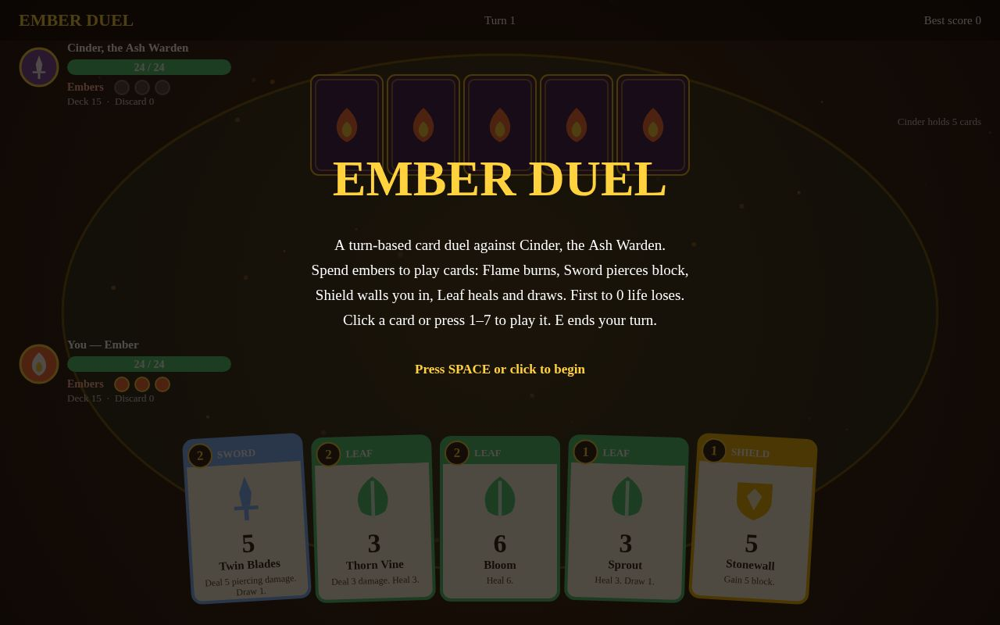
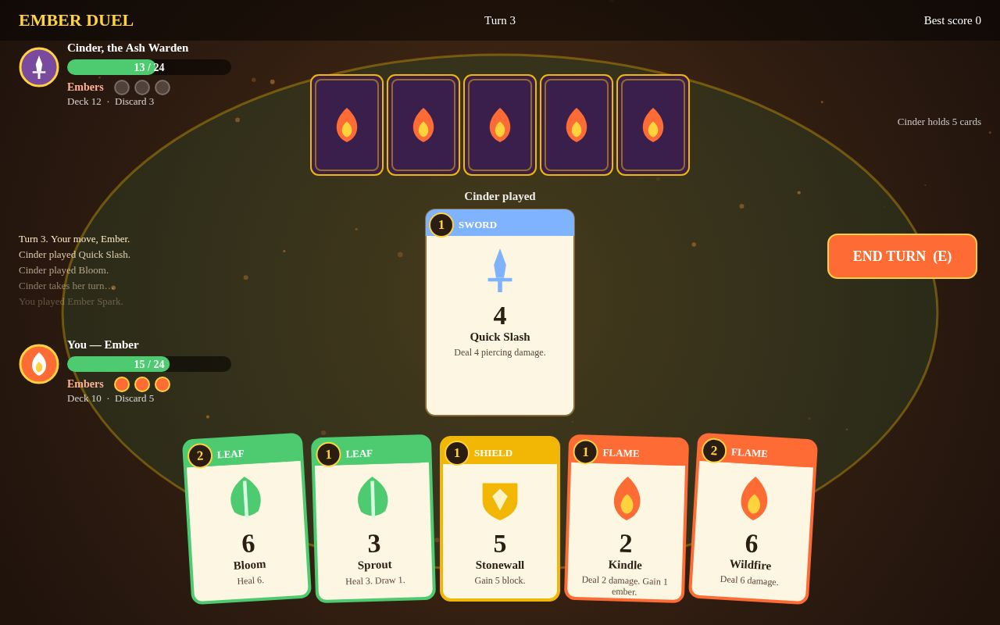
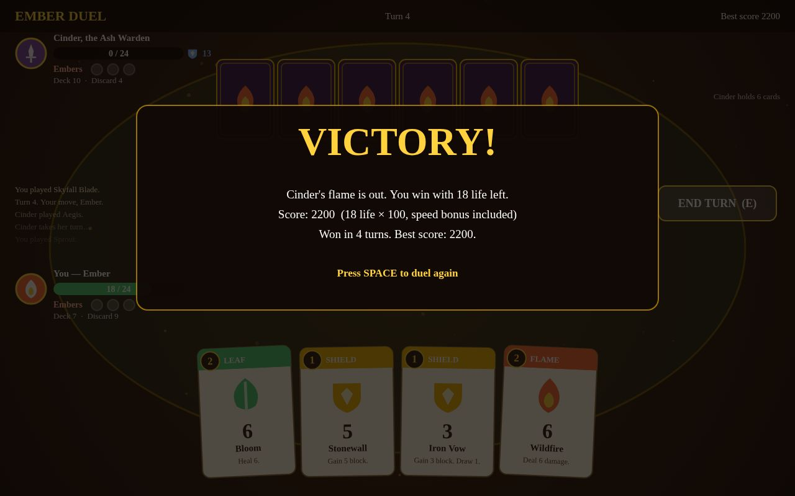
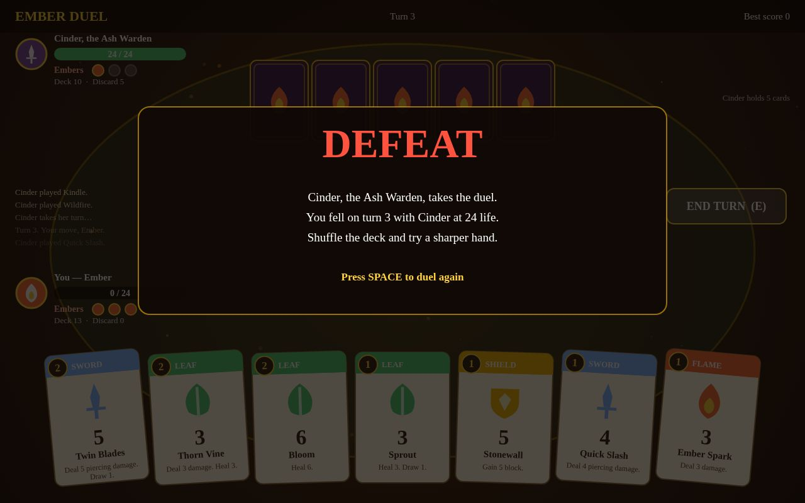

# Ember Duel

A turn-based card duel against **Cinder, the Ash Warden**. You and Cinder each
have 24 life, a 20-card deck, and 3 embers a turn. Play cards, break through
her block, heal when you must — first to 0 life loses.

## How to play

- **Click a card** (or press `1`–`7`) to play it. Playing costs embers — the
  number in the gold gem, top left of each card.
- **E** or the **END TURN** button ends your turn. Cinder then plays hers,
  one card at a time, so you can see each blow land.
- **Space / Enter** starts a duel and starts a new one after a win or a loss.
  **P** pauses.
- `?seed=N` fixes the decks for a repeatable duel. `?autoplay=1` lets the
  autopilot play a whole duel on its own. `?shot=start|play|end|loss` stages
  a screenshot scene.

Serve it with `node serve.ts` and open http://localhost:8080 — no build step,
no network, everything is static files under `game/`.

## The cards

Four suits, told apart by colour **and** shape, never by text alone:

| Suit | Colour | Shape | What it does |
| --- | --- | --- | --- |
| Flame | red-orange | flame | Damage, reduced by block |
| Sword | steel blue | sword | Piercing damage — ignores block |
| Shield | gold | shield | Block — absorbs damage until your next turn |
| Leaf | green | leaf | Heal and draw |

Sixteen original cards, from **Ember Spark** (1 ember, 3 damage) to
**Inferno** (3 embers, 10 damage), **Skyfall Blade** (8 piercing damage),
**Aegis** (13 block) and **Thorn Vine** (3 damage and 3 heal in one card).
Combo cards such as **Twin Blades** (pierce + draw) and **Kindle** (damage +
an extra ember) reward hands that chain together.

## Rules

- Each duelist starts at **24 life** with a shuffled **20-card deck** and a
  **5-card opening hand**.
- Each turn refills your embers to **3** and draws **2 cards** (hand cap 7).
  When the draw pile runs out, the discard pile is shuffled back in.
- Block absorbs damage but **piercing damage ignores it**; block clears at
  the start of your next turn. Healing never goes above 24 life.
- Cinder reads the table: she pierces when you hide behind block, heals and
  walls up when her life runs low, and takes the killing blow when she sees it.
- A duel that runs past 40 turns is decided by life — the healthier duelist wins.
- **Score on a win:** life left × 100, plus 25 for every turn under 20.

## Screenshots

| | |
| --- | --- |
|  |  |
|  |  |

Title, a mid-game table (both hands, life and embers visible), victory and
defeat — all real renders of the game itself, staged with `?shot=…&seed=11`.

## Layout

- `game/index.html` — the page; `game/src/` — the game, one job per file:
  `config.js` (constants and suits), `random.js` (seeded RNG), `cards.js`
  (the card catalogue), `deck.js` (draw/discard piles), `engine.js` (turns
  and rules), `ai.js` (Cinder), `render.js` (the canvas table), `sound.js`
  (WebAudio synth), `input.js` (mouse and keyboard), `shots.js` (screenshot
  staging and the autopilot), `main.js` (boot and the game loop).
- `main.ts` — the entry program (Node 22, stdlib only): copies `game/` and
  `screenshots/` to `/output` and writes `dossier.json` with the vendored
  make.fun library in `vendor/makefun-game.ts`.
- `screenshots/` — the four screenshots above, 1280×800 JPEGs.
- `serve.ts` — a tiny static server for local play.

## License

MIT — see [LICENSE](LICENSE).
